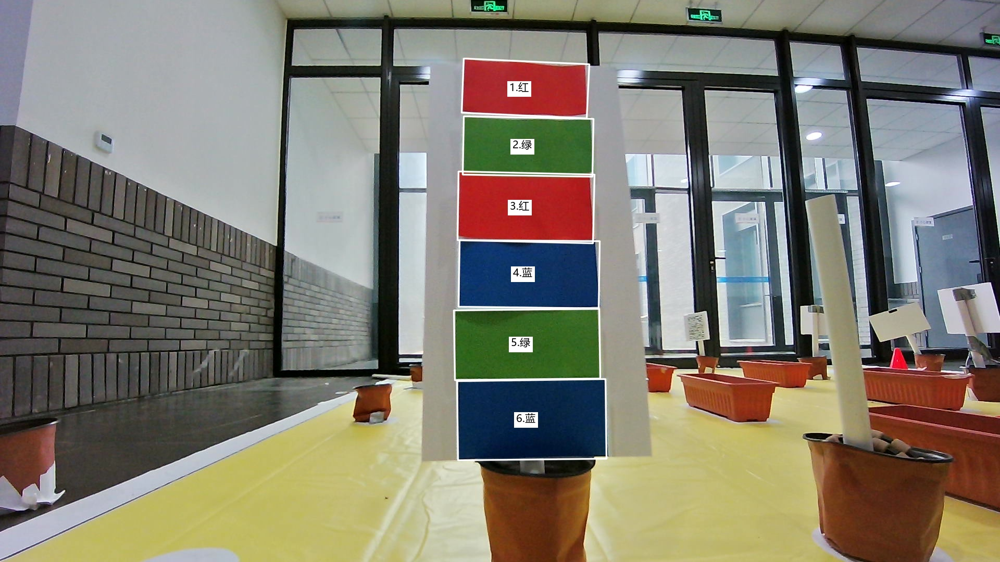
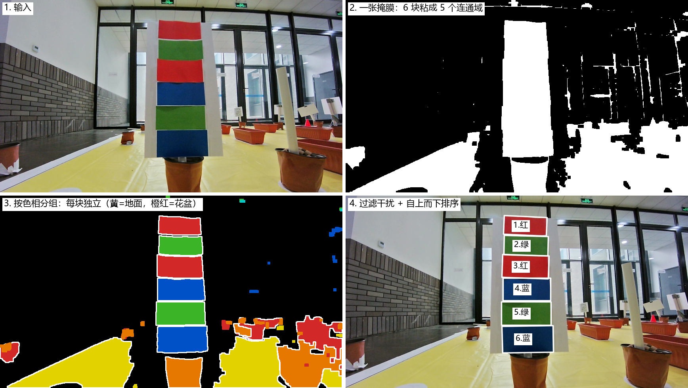

# openCV信息板色块识别

## 效果

## 实现流程

1.RGB转HSV，便于识别不同光线下的色块

2.按照色相分组进行掩膜，滤掉饱和度与亮度过低的部分

3.形态学操作，先闭后开处理噪点与轮廓边缘

4.轮廓检测，按照色块相对面积占比、长宽比、矩形度滤出干扰

5.对目标块识别色相

## 参数

| 参数       | 参数值    |
| ---------- | --------- |
| 饱和度范围 | (100,255) |
| 亮度范围   | (45,255)  |
| 长宽比下限 | 1.4       |
| 矩形度下限 | 0.85      |
| 面积占比   | 0.2%~15%  |

## 数据集结果

在该算法与参数下，数据集180张图片识别准确率约为64%，单张运行时间约71ms

主要问题在于色块数量检测有误：

- 有部分花盆被识别为目标色块

- 对于部分图片绿色色块识别不出

我的优化思路：

- 该场景下色块排列于同一列，按x聚列后仅保留色块数最多的一列

- 绿色的平均饱和度和明度比红蓝都低，当光照下降时S值跌破设定的S下限阈值导致被掩膜覆盖

对于第二条问题我没有想到好的方案，如果直接改掩膜阈值可能导致在数据集过拟合或影响其它两种颜色识别的问题

在优化后平均准确率达到约73%
