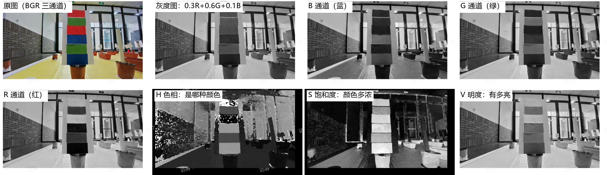

# 讲义：第 1 ~ 3 课

> 配套实验在同一个目录：`l1_image_is_data.py`（第 1、2 课）、`l3_mask.py`（第 3 课）。
> 课程表在 `README.md`。这份文件是**讲解正文**，忘了可以随时回来翻。

---

## 第 1 课：图像就是一摞数字

先跑 `l1_image_is_data.py`，它会打印这些：

```
图片形状 shape = (480, 830, 3)      # (高=480, 宽=830, 通道=3)
数据类型 dtype = uint8              # 每个数 0~255
总像素数 = 398,400 个，每个像素 3 个数
左上角像素 bgr[0,0] = [255 255 255]  # 顺序是 B, G, R ！
```

### 四个必须记住的事实

1. **shape 是（高, 宽, 通道）**，不是（宽, 高）。
   所以取像素永远写 `img[y, x]`：y 是行（往下数），x 是列（往右数）。
   这是所有人的第一个坑 —— 把 x/y 写反，程序不报错，只是结果莫名其妙。

2. **uint8**：每个数只有 0~255 这 256 档。
   所以 `img + 50` 会溢出（255+1 变 0）。要加减乘除先 `img.astype(np.float32)`。

3. **通道顺序是 B、G、R**，不是 RGB。
   `cv2.imread` 读出来就是 BGR；用它自己的 `cv2.imshow` / `cv2.imwrite` 没问题，
   但交给 matplotlib 显示就会红蓝互换 —— 要么 `cv2.cvtColor(img, cv2.COLOR_BGR2RGB)`，要么记住这个坑。

4. **灰度图**：三通道按 `0.299R + 0.587G + 0.114B` 压成一个数。
   绿权重最大是因为人眼对绿最敏感。这也是"图像处理里为什么经常先转灰度"的原因 —— 信息量减少 2/3，但结构还在。

### 现象：不同颜色 = 不同通道的数值配比



看第二排第一张 R 通道：**红块是亮的、蓝块是暗的**；看 B 通道正好相反。
"识别颜色"本质上就是**读这三个数的配比**，不是什么玄学。

---

## 第 2 课：为什么判颜色不能用 RGB，要用 HSV

同一个红块，跑 `l1_image_is_data.py` 会打印两组数（原图 / 整张图调暗一半）：

|          | BGR           | H 色相  | S 饱和 | V 明度 |
| -------- | ------------- | ------- | ------ | ------ |
| 原图     | (38, 35, 163) | **179** | 200    | 163    |
| 调暗一半 | (19, 17, 81)  | **179** | 201    | 81     |

**BGR 三个数全变了，V 掉了一半，但 H 一点没动。** 绿块 55→55、蓝块 108→108、
白板 25→25、地面 28→28，全部不变。

### 三个分量各管什么

- **H 色相** = "这是哪种颜色"，范围 0~179（等于角度除以 2）。
  红≈0 或 179、橙≈15、黄≈30、绿≈55、青≈90、蓝≈108、紫≈145。
  **它描述的是三通道的"比例"，不是绝对亮度，所以光照变了它基本不变。**
- **S 饱和度** = "颜色有多浓"。白墙 S≈21，色块 S≈150~235。
  教学文档里说"饱和度越高色彩越纯，低则逐渐变灰"，就是这个意思。
- **V 明度** = "有多亮"。整张图调暗，V 就减半。

### 对应到代码

作业里这句：

```python
cv2.inRange(hsv, (0, 90, 45), (180, 255, 255))
```

三个下限 `0 / 90 / 45` 的意思是：H 不管（0~180 全要）、**S ≥ 90 才算"浓色"**、
**V ≥ 45 才算"不是黑的"**。

### 一个容易漏掉的点（面试可以讲）

看 `channels.png` 里 `H 色相` 那一格，白墙区域是**一片雪花噪声**。
原因：白墙 S 只有 21，三通道数值差不多，而"比例"在低饱和时几乎由噪声决定。
所以 **`S ≥ 90` 不只是筛掉灰白背景，它同时在保护 H 不失效** —— 先保证"够浓"，H 才有意义。

---

## 第 3 课：掩膜 —— 用一张黑白图去"遮"另一张图

对应教学文档 2.1.3 那句："掩膜是用一幅二值化图像对另外一幅图像进行局部的遮挡，
具体实现上是使用一张二值化图像与另一幅图像做位运算。"

### 两步，就两行代码

```python
mask = cv2.inRange(hsv, (0, 90, 45), (180, 255, 255))   # ① 二值化 → 得到掩膜
filtered = cv2.bitwise_and(img, img, mask=mask)         # ② 位运算 → 只留色块
```

- `inRange` 逐像素判断：三个分量都落在区间里就写 **255**，否则写 **0**。
  得到的是一张**单通道黑白图**，白 = 保留，黑 = 丢掉。
- `bitwise_and(img, img, mask=mask)`：掩膜为 255 的像素照抄原图，为 0 的地方输出 0（全黑）。
  这就是文档里 `original image → filtered image` 的那一步。


### 现象：阈值不是越高越干净

同一个掩膜，只改 S 下限：

| S 下限 | 白像素占比 | 大色块数 | 现象                           |
| ------ | ---------- | -------- | ------------------------------ |
| 60     | 29.9%      | 10       | 地面、花盆、玻璃反光全被算进来 |
| **90** | 24.1%      | 8        | 作业用的值                     |
| 160    | 12.7%      | 9        | **绿色块（S≈150）被削没了**    |

**结论：阈值偏低会"多认"（地面混进来），偏高会"漏认"（绿块消失）。**
阈值就是在两类错误之间取舍 —— 这句话比任何定义都值钱，面试时直接说。

### 自己动手改一遍

把 `l3_mask.py` 里的 `(60, 90, 160)` 改成 `(30, 90, 200)` 再跑，亲眼看"太低混进来、太高削掉"。

---

## 检查题

**Q1. `shape` 为什么是 `(480, 830, 3)`？取"第 100 列、第 50 行"的像素怎么写？**

**Q2. 红块原图 BGR=(38,35,163)，调暗一半变 (19,17,81)，H 会变吗？为什么？**

**Q3. `H 色相` 那张图里白墙全是雪花噪声，说明什么？哪个参数在防这个？**
