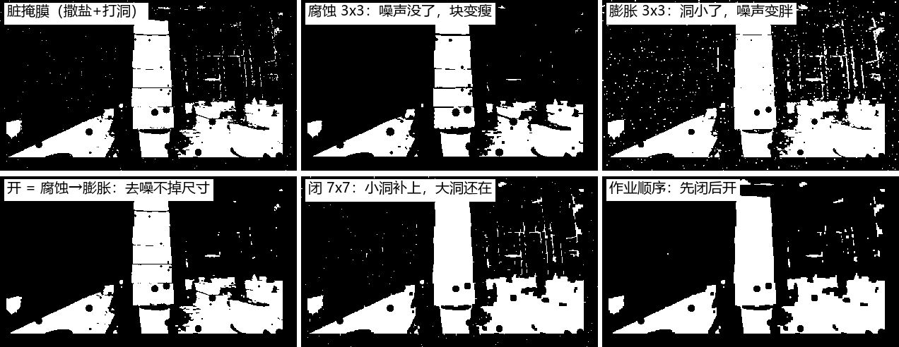

# 讲义：第 4 课 · 形态学（腐蚀 / 膨胀 / 开 / 闭）

> 实验：`l4_morphology.py`　对应教学文档 2.1.6
> 对应作业代码：`task1_color_blocks.py` 里的 `MORPH_CLOSE` / `MORPH_OPEN` 那四行

---

## 1. 为什么需要它

`inRange` 得到的掩膜永远不完美，最常见的两类脏：

- **该白的不白**：色块上有高光反射，掩膜里出现小黑洞 → 面积算小、矩形度算低；
- **该黑的不黑**：窗框反光、地面噪点，掩膜里出现零散小白点 → 后面 `findContours` 会多出一堆假轮廓。

形态学就是干这两件事的：**补洞、去噪**。而且它只改形状、不看颜色，所以是掩膜阶段的"修边工具"。

## 2. 两个原子操作

形态学的每一步都是拿一个**结构元素**（kernel，一个 n×n 的小方块，内容全 1）在图上滑动。

**腐蚀（erode）= 邻域取最小**
kernel 盖住的区域里只要有一个黑像素，中心就变黑 → **白色区域收缩一圈**。
效果：小噪点（本身只有几个像素）直接消失，但色块边界也往里缩。

**膨胀（dilate）= 邻域取最大**
kernel 盖住的区域里只要有一个白像素，中心就变白 → **白色区域扩张一圈**。
效果：小洞被填上，但噪点也变胖、相邻目标会粘在一起。

一句话记：**腐蚀让白变瘦，膨胀让白变胖。**

## 3. 开和闭 = 两个原子操作的组合

| 运算             | 顺序            | 直觉             | 效果            | 代价                                     |
| ---------------- | --------------- | ---------------- | --------------- | ---------------------------------------- |
| **开运算** open  | 先腐蚀 → 后膨胀 | 先瘦一圈再胖回来 | 去掉小白点/毛刺 | 大形状基本保持，但尖角会被磨圆、整体略瘦 |
| **闭运算** close | 先膨胀 → 后腐蚀 | 先胖一圈再瘦回来 | 填补小黑洞/裂缝 | 大形状基本保持，但相邻目标容易被连起来   |

**关键理解：为什么"开"能去噪却不缩小目标？**
腐蚀时噪点（只有 1~3 像素）被彻底擦掉，同时色块缩了一圈；膨胀时色块长回去，但噪点已经没了，长不回来。
所以**一去一回，大目标复原、小目标消失**——这就是"开"的作用原理。
闭运算同理：膨胀时洞被填上，腐蚀时外轮廓缩回去，洞填了就不会再出现。

## 4. 实测数字（`l4_morphology.py` 的输出）

我把原始掩膜故意弄脏（撒 0.2% 盐粒 + 打 15 个小洞 + 10 个大洞），然后逐个操作：

| 操作                 | 白像素占比 | 小噪点(<50px) | 大块数 | 面积保留 |
| -------------------- | ---------- | ------------- | ------ | -------- |
| 原始掩膜（基准）     | 24.1%      | 292           | 8      | 96%      |
| 脏掩膜               | 23.5%      | 870           | 8      | 93%      |
| 腐蚀 3×3             | 20.8%      | **46**        | 8      | 85%      |
| 膨胀 3×3             | 27.8%      | 625           | 5      | 101%     |
| 开运算 3×3           | 22.7%      | **32**        | 8      | 92%      |
| 闭运算 7×7           | 25.1%      | 560           | 4      | **98%**  |
| 先闭后开（作业顺序） | 24.5%      | **27**        | 4      | **98%**  |



读法：

- 腐蚀确实把噪点从 870 打到 46，但面积掉了 15%（块瘦了）；
- 膨胀面积回到 101%，可噪点几乎没降（625）—— 一胖全胖；
- **开运算两头都要**：噪点 32（比原始掩膜还干净），面积还留 92%；
- 闭运算把洞补回来（93%→98%），但**大块数从 8 掉到 4，说明相邻目标被粘连了**；

## 5. kernel 尺寸怎么定（面试会问"为什么 7×7"）

对脏掩膜做开运算，kernel 从 3 变大到 25：

| kernel | 小噪点 | 面积保留 |
| ------ | ------ | -------- |
| 3×3    | 32     | 92%      |
| 7×7    | 1      | 89%      |
| 15×15  | 0      | 85%      |
| 25×25  | 0      | 75%      |

对脏掩膜做闭运算：

| kernel | 面积保留 | 大块数 |
| ------ | -------- | ------ |
| 3×3    | 94%      | 6      |
| 7×7    | 98%      | 4      |
| 15×15  | 118%     | 6      |
| 21×21  | 144%     | 3      |

结论两条：

1. **kernel 越大越"干净"，但目标也被啃得越多**（开 25×25 只剩 75% 面积）；
2. **闭运算 kernel 大了会把相邻目标连成一片**（21×21 面积涨到 144%，大块数掉到 3）——对这道题是致命的，因为相邻色块一粘，就分不出 6 个了。

**所以 7×7 的依据是**：色块约 100×45 像素，高光洞一般只有 3~10 像素，7×7 够补小洞；
再大就会开始啃边界、粘连相邻块。这不是拍脑袋，是"洞的尺寸"和"块间距"之间的折中。

## 6. 为什么作业是"先闭后开"

```python
mask = cv2.morphologyEx(mask, cv2.MORPH_CLOSE, kernel)   # ① 先补洞
mask = cv2.morphologyEx(mask, cv2.MORPH_OPEN,  kernel)   # ② 再去噪
```

- 先闭：把色块内部的洞补上，让色块**完整**（后面算面积、矩形度才准）；
- 后开：把外部的碎噪点清掉，让色块**独立**（后面算轮廓个数才对）。

**能反过来吗？** 顺序反了不会崩，但会先被"开"啃掉一圈边界再补洞；
更要紧的是**开运算不可逆**：噪点、细边一旦被腐蚀掉，后面的膨胀是长不回来的。
所以一般原则是：**先补（闭）再修（开），先保证完整性，再保证独立性。**

## 7. 对应到代码

```python
kernel = cv2.getStructuringElement(cv2.MORPH_RECT, (7, 7))
mask = cv2.morphologyEx(mask, cv2.MORPH_CLOSE, kernel)   # 补洞
mask = cv2.morphologyEx(mask, cv2.MORPH_OPEN, kernel)    # 去噪
```

`getStructuringElement` 还有 `MORPH_ELLIPSE`（圆形）和 `MORPH_CROSS`（十字）。
色块是方的、洞是圆的，所以**圆核更"不伤方角"**，这也是一个可以尝试的改进点（换成椭圆核看结果）。

---

## 8. 补充：把 CLOSE / OPEN 交换顺序会怎样（实测）

在 `demo/board.png` 上，同一张原始掩膜、同一个 7×7 kernel，只换顺序：

| 顺序             | 轮廓总数 | 大轮廓(≥0.2%) | 中轮廓(≥50px) |
| ---------------- | -------- | ------------- | ------------- |
| 先闭后开（作业） | 17       | 5             | 13            |
| 先开后闭（交换） | **11**   | 5             | 9             |

**结论：交换后轮廓数变少（17 → 11），但"少"不等于"好"。**

原因：**闭运算会把挨得近的噪点粘连放大成中等团块**，这个团块尺寸已经超过 kernel，后面的开运算清不掉；
而先开时噪点会被直接清掉，后面闭就没有东西可粘。

真正该用的判据不是"轮廓总数最少"，而是 **"6 个色块都在 + 假轮廓少"**。
而且**先开会把洞变大**（腐蚀 = 白区收缩 = 黑洞扩张），先闭是趁洞还小先补上 —— 这才是「先闭后开」的硬理由。

（两种顺序的大轮廓都是 5 个，剩下的差异由后面的**几何过滤**补齐 —— 这也说明形态学只负责"大致干净"，精筛是下一步的事。）

---

## 检查题

**Q1.** 为什么"开运算"能去掉小白点、却基本不缩小大色块？用"腐蚀→膨胀"这个顺序解释。

**Q2.** 如果我把 kernel 从 7×7 换成 31×31，作业里的 6 个色块会发生什么？两个可能的坏结果分别是什么？

**Q3.**（对代码）作业里 `MORPH_CLOSE` 和 `MORPH_OPEN` 这两行如果交换顺序，`findContours` 拿到的轮廓数会变多还是变少？为什么？
